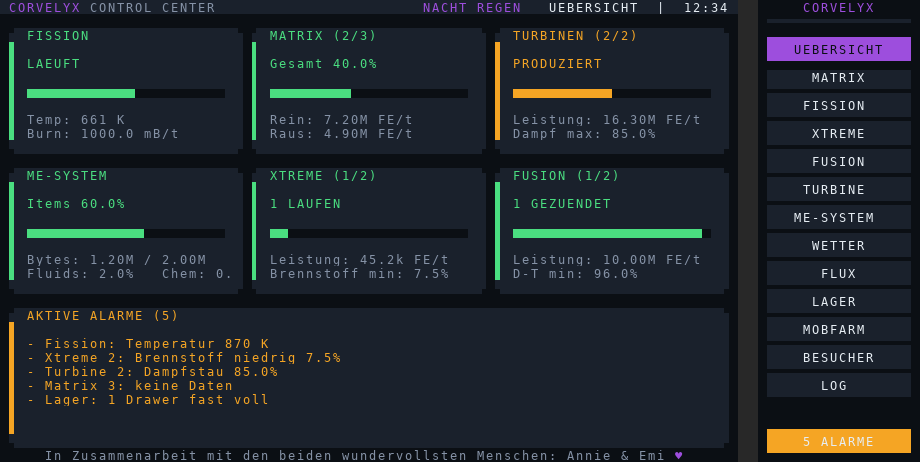
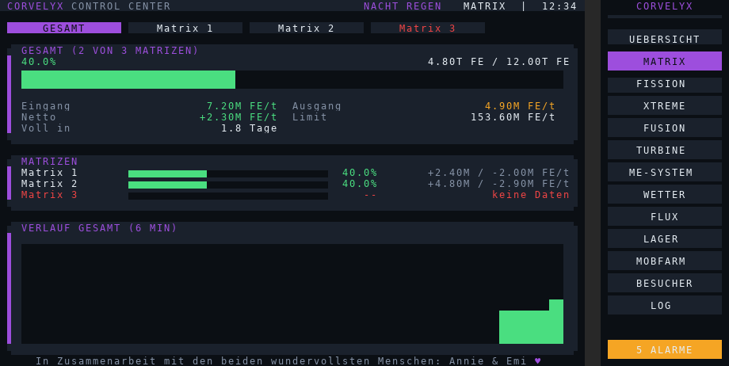
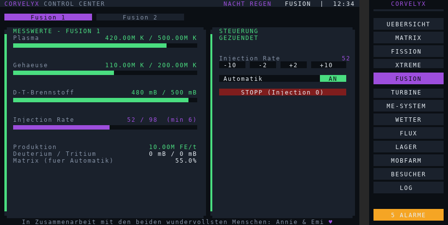
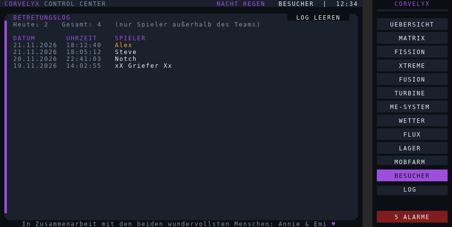
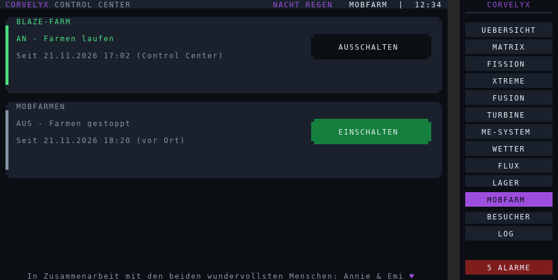
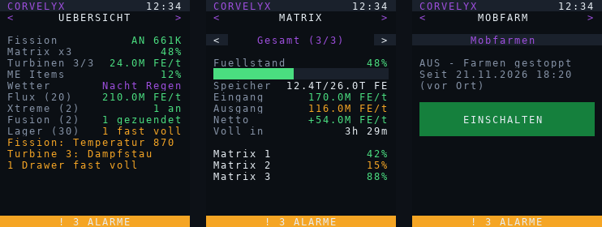

# Corvelyx

**Ein Leitstand für deine ATM10-Basis, gebaut mit ComputerCraft.**
Reaktoren, Energiespeicher, ME-System, Wetter, Mobfarmen und Besucher auf einen Blick, gesteuert per Touch-Monitor oder Pocket Computer. Updates kommen automatisch aus diesem Repo.

*In Zusammenarbeit mit den beiden wundervollsten Menschen: Annie & Emi ♥*



---

## Was Corvelyx kann

| Bereich | Funktionen |
|---|---|
| **Control Center** | Touch-Bedienung auf großen Monitoren mit Menü-Monitor daneben. Startseite mit Kacheln für alle Anlagen und aktiven Alarmen. Seiten erscheinen nur für Systeme, die wirklich angeschlossen sind. |
| **Fission** | Reaktor-Wächter mit automatischer Notabschaltung (SCRAM) bei Hitze, Schaden, Kühlmangel oder vollem Abfall. Start, Stop und Not-Aus aus der Ferne. |
| **Fusion** | Mehrere Mekanism-Fusionsreaktoren mit Plasma, Gehäuse, D-T-Brennstoff und Injection Rate. Automatik regelt die Leistung nach dem Füllstand der Matrizen. Zünden per Laser auf Knopfdruck oder automatisch, mit Hohlraum-Prüfung und Zeitlimit. |
| **Extreme Reactors** | Leistung, Brennstoff, Steuerstäbe und Automatik pro Reaktor. |
| **Matrix** | Beliebig viele Induction Matrizen mit Gesamt-Ansicht (Speicher, Eingang, Ausgang, Netto, Zeit bis voll oder leer) und Verlauf. |
| **Turbinen** | Produktion und Dampf jeder Turbine. |
| **ME-System** | Belegung von Items, Fluids und Chemicals. |
| **Wetter** | Tageszeit, Wetter und Mondphase. Steuerung über Celestial Manipulators, auch für normale Spieler. |
| **Flux & Lager** | Flux-Plugs über Energy Detectors, Füllstand der Functional-Storage-Drawer. |
| **Mobfarmen** | Ersetzt den Hebel am Create Redstone Link: dauerhaftes Signal, schaltbar vom Control Center, Pocket oder vor Ort. |
| **Besucher** | Betretungslog an der Tür: Spieler außerhalb des Teams werden mit Datum und deutscher Uhrzeit protokolliert. |
| **Chat-Alarme** | Mit einer Chat Box am Control Center gehen Alarme als Chat-Nachricht nur an die eingetragenen Team-Spieler. Fällt die Server-TPS ab, bekommen alle Spieler eine Warnung. |
| **Pocket** | Alle Seiten im Kleinformat für unterwegs, inklusive Steuerung. |
| **Sprache** | Deutsch oder Englisch für das ganze Netz, einmal am Update-Computer umgeschaltet. |

<table>
<tr>
<td></td>
<td></td>
</tr>
<tr>
<td></td>
<td></td>
</tr>
</table>



---

## Was du brauchst

- **CC: Tweaked** (ist in ATM10 enthalten), HTTP muss auf dem Server erlaubt sein (Standard)
- **Ender Modems** an jedem Computer
- **Advanced Monitore** für das Control Center, empfohlen: 8×5 Hauptmonitor + 2×5 Menü
- **Advanced Peripherals** für ME Bridge, Player Detector und Chat Box
- Je nach Anlage: Mekanism Logic Adapter, Induction Port, Turbine Valve, Computer Port (Extreme Reactors), Energy Detectors, Functional Storage Controller

Jeder Computer braucht eine **eigene ID**. Nimm frisch gecraftete Computer und kopiere sie nicht im Kreativmodus, sonst teilen sie sich ihre Festplatte.

---

## Schnellstart

### 1. Update-Computer (einmal pro Netz)

1. Neuen Computer mit Ender Modem aufstellen, am besten in einem geclaimten und gechunkloadeten Chunk.
2. Im Computer diesen einen Befehl eintippen:
   ```
   wget run https://raw.githubusercontent.com/LunyaReqiq/corvelyx/main/programme/lader.lua
   ```
   (Alternativ [`programme/lader.lua`](programme/lader.lua) herunterladen, ins Computerfenster ziehen und `lader` eintippen.)
3. **10** (Update-Computer) wählen.
4. Einen **eigenen Netznamen und ein eigenes Passwort** ausdenken und eintragen. Benutzer, Repo, Branch und Ordner mit Enter übernehmen, den Token leer lassen.

Auf dem Bildschirm sollte danach „OK – … Programme“ stehen.

### 2. Alle anderen Computer

1. Computer mit Ender Modem an die Anlage stellen.
2. Den gleichen `wget run …`-Befehl eintippen (oder `lader.lua` ins Fenster ziehen und `lader` eintippen).
3. Programm auswählen und Netz und Passwort eintragen, genau wie beim Update-Computer.

Läuft auf dem Computer schon ein altes Corvelyx-Programm, erkennt der Lader es und übernimmt die Einstellungen. Die Sicherung landet in `startup_alt.lua`.

---

## Wie die Updates laufen

```
GitHub ──> Update-Computer ──Funknetz, signiert──> alle Corvelyx-Computer
```

- Jeder Computer hat `lader.lua` als `startup.lua`. Beim Start fragt er den Update-Computer nach seinem Programm.
- Der Update-Computer prüft dieses Repo alle 10 Minuten bzw. sofort, wenn unter **LOG → UPDATE** (oder im Pocket unter **UPDATES**) gedrückt wird.
- Ändert sich eine Datei, starten **nur die Computer neu, die genau dieses Programm haben**.
- Ist der Update-Computer aus, starten alle mit ihrer gespeicherten Version.

## Sicherheit

- Netzname, Passwort, Namen und eigene Einstellungen stehen auf jedem Computer in `corvelyx.cfg` und **nie in diesem Repo**.
- Alle Nachrichten sind mit dem Passwort signiert (SHA-256), Befehle zusätzlich mit Einmal-Codes. Mehrere Netze auf demselben Server stören sich nicht, und Fremde können nichts steuern.

---

## Programme

| Datei | Computer |
|---|---|
| `lader.lua` | auf jedem Computer (wird zur `startup.lua`) |
| `update_server.lua` | Update-Computer (holt die Programme von GitHub) |
| `corvelyx_cc.lua` | Control Center |
| `corvelyx_pocket.lua` | Advanced Pocket Computer |
| `reaktor_waechter.lua` | Fission Logic Adapter |
| `fusion_reaktor.lua` | Fusion Logic Adapter |
| `xtreme_reaktor.lua` | Extreme Reactors Computer Port |
| `corvelyx_sender.lua` | Induction Port / Turbine Valve / ME Bridge (Name in der cfg) |
| `flux_sender.lua` | Flux Plugs (Energy Detectors) |
| `lager_sender.lua` | Functional Storage Controller |
| `corvelyx_wetter.lua` | Wetter-PC (Celestial Manipulators) |
| `tuer_sender.lua` | Betretungslog: Player Detector an der Tür |
| `mobfarm.lua` | Mobfarm-Schalter: dauerhaftes Redstone-Signal zum Create Redstone Link |
| `laser_zuender.lua` | Laser-Zünder am Laser Amplifier („Laser 1“ gehört zu „Fusion 1“) |

## Sprache / Language

Corvelyx läuft auf Deutsch oder Englisch. Die Sprache gilt immer für das **ganze Netz** und wird nur am Update-Computer eingestellt: dort **S** drücken. Der Update-Computer startet neu, alle anderen Computer übernehmen die Sprache und starten ebenfalls neu. Auch die TPS-Warnung im Chat kommt in dieser Sprache.

*Corvelyx speaks German or English. The language always applies to the whole network and is set on the update computer only: press **S** there. All other computers pick it up and restart automatically.*

## Einstellungen ändern

Am jeweiligen Computer: **Strg+T**, `edit corvelyx.cfg`, ändern, speichern, `reboot`.
Programme selbst nicht bearbeiten, sie werden beim nächsten Update ersetzt.

## Häufige Probleme

| Problem | Lösung |
|---|---|
| „Kein Ender Modem gefunden“ | Ender Modem direkt an den Computer, nicht auf dieselbe Seite wie ein anderes Gerät. |
| Zwei Computer tauschen ihre Rolle | Sie haben dieselbe ID. Einen davon durch einen frisch gecrafteten Computer ersetzen. |
| „Update-Computer nicht erreichbar“ | Läuft er? Gleicher Netzname und gleiches Passwort (Groß-/Kleinschreibung)? |
| Update-Computer meldet GitHub-Fehler | HTTP in `serverconfig/computercraft-server.toml` erlaubt? Benutzer- und Repo-Name richtig? |
